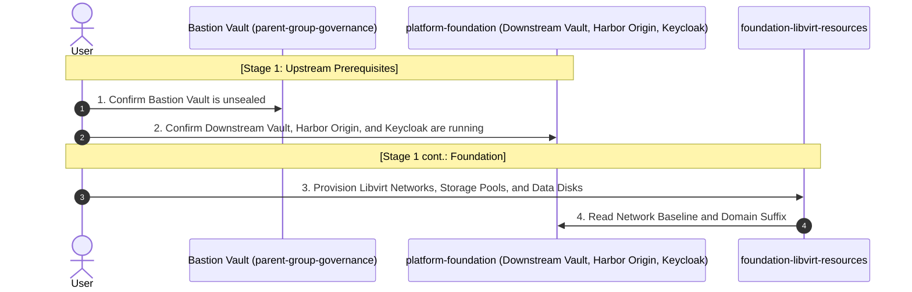
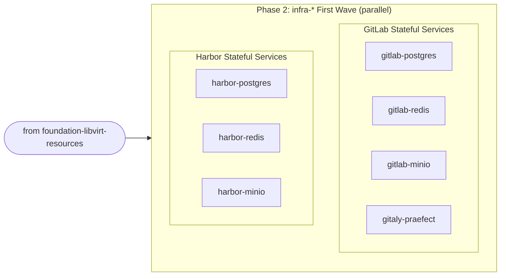
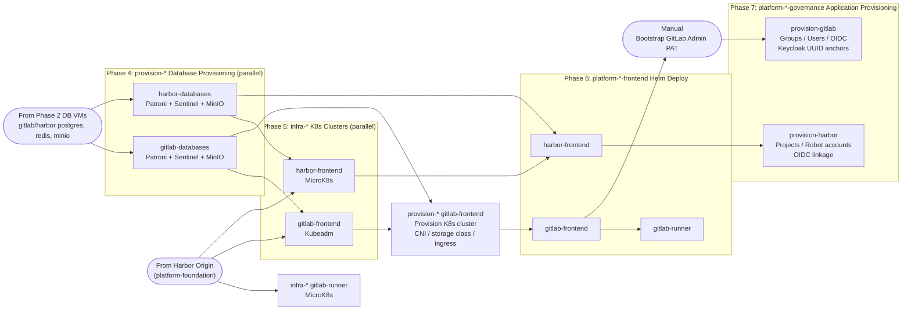

# Deployment Order

Each layer reads prior layers' state via `terraform_remote_state`. Layers within the same phase can be applied in parallel unless noted otherwise.

---

## Pre-Flight

Before applying any Terraform layer, complete all steps in [Prerequisites](01-prerequisites.md) and [Initialization](02-initialization.md).

---

## Dependency Diagrams

Three left-to-right diagrams, each building on the previous stage.

---

### Stage 1: Upstream Prerequisites and Foundation

---

### Stage 2: Stateful Services

> All `infra-*` VM layers follow the same pattern: authenticate to the Downstream Vault, then receive a TLS leaf certificate (auto-rotated by Vault Agent sidecar).

---

### Stage 3: Harbor + GitLab Deployment

---

## Notes

1. **governance-gitlab-project: GitLab.com Project (Optional)**

    `governance-gitlab-project` can be applied at any point and depends on no layer of this repository. An existing project requires a first-time `terraform import` of the project and the `main` branch protection before applying. See [Initialization: GitLab.com Project Governance](02-initialization.md#gitlabcom-project-governance).

2. **platform-gitlab-frontend: `OpenSSL::Cipher::CipherError`**

    If this error occurs in the `gitlab-migrations` pod, see the [troubleshooting guide](../operations/troubleshooting.md#gitlab-application). Caused by `rails-secret` regeneration against a preserved database from a prior deployment.
